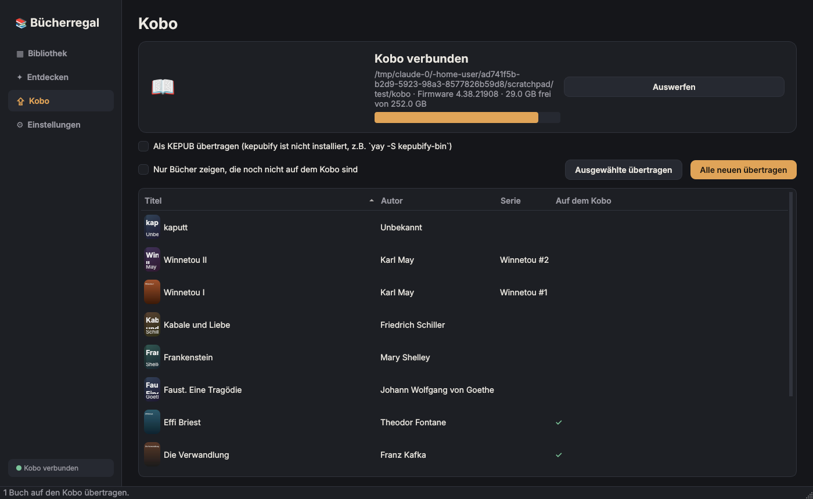

# Bücherregal

Desktop-App für deine deutschen EPUBs mit Kobo-Anbindung. Läuft mit Python und PySide6 (Qt) unter Linux.


## Was sie kann

- **Bibliothek**: scannt deinen Bücherordner (Standard `~/Bücher`, inkl. Unterordner) und zeigt alle EPUBs als Cover-Raster. Rechts gibt es die Details: Titel, Autor, Serie mit Bandnummer, Sprache, Jahr, Verlag, ISBN, Genres und Beschreibung. Bücher ohne Cover bekommen ein generiertes.
- Suche (Titel, Autor, Serie, Genre), Sortierung (zuletzt hinzugefügt, Titel, Autor, Serie) und Filter „Nur deutsche Bücher“. Nicht-deutsche Bücher haben ein Sprach-Badge.
- **Import**: EPUBs einfach ins Fenster ziehen oder über den Button wählen. Sie werden als `Autor - Titel.epub` in die Bibliothek kopiert. Andere Formate werden abgelehnt.
- **Kobo**: wird automatisch erkannt, sobald er per USB verbunden ist (`/run/media/$USER/KOBOeReader`). Einzelne, ausgewählte oder alle neuen Bücher übertragen, Speicherplatz sehen, sicher auswerfen. Bücher, die schon drauf sind, bekommen einen grünen Haken.
  Mit installiertem [kepubify](https://pgaskin.net/kepubify/) wird automatisch nach KEPUB konvertiert (schnellere Seitenwechsel, Lesestatistik): `yay -S kepubify-bin`
- **Entdecken**: gemeinfreie deutsche Bücher legal und kostenlos herunterladen
  - Project Gutenberg (über die Gutendex-API, gefiltert auf Deutsch + EPUB)
  - Wikisource (deutschsprachige Texte, EPUB-Export über ws-export)
  - Internet Archive (nur deutsche Bücher mit Gemeinfrei-Kennzeichnung, keine Leih-Exemplare). Das sind meist alte Scans, die EPUBs entstehen per Texterkennung, die Qualität schwankt also.
  - eigene OPDS-Kataloge, z.B. dein eigener Calibre-Server (in den Einstellungen hinzufügen)
- **Downloads beobachten**: neue EPUBs in `~/Downloads` (z.B. gekaufte DRM-freie Bücher) landen automatisch in der Bibliothek, doppelte werden übersprungen. Ordner, An/Aus und „Original danach in den Papierkorb“ stellst du in den Einstellungen ein. Mit „Jetzt alle importieren“ holst du auch EPUBs, die schon vorher dort lagen.
- Rechtsklick-Menü, Doppelklick öffnet das Buch im Standard-Reader (z.B. Foliate), Löschen landet im Papierkorb. `Strg+F` springt in die Suche.



## Starten

```bash
cd ~/Projekte/Buecherregal
./start.sh
```

Beim ersten Start legt `start.sh` eine eigene Python-Umgebung (`.venv`) an und installiert PySide6 dort. Wenn du lieber das Systempaket nimmst: `sudo pacman -S pyside6`, dann nutzt `start.sh` das direkt.

Für einen Eintrag im App-Menü (Rofi, Fuzzel, Walker usw.):

```bash
./install-desktop.sh
```

## Wo was liegt

| Was | Pfad |
|---|---|
| Deine Bücher | `~/Bücher` (änderbar in den Einstellungen) |
| Metadaten-Cache | `~/.local/share/buecherregal/library.db` |
| Cover-Cache | `~/.cache/buecherregal/covers/` |
| Einstellungen | `~/.config/buecherregal/buecherregal.conf` |
| Bücher auf dem Kobo | Ordner `Bücher/` auf dem Reader |

Cache und Cover kannst du jederzeit löschen, die App baut sie beim nächsten Scan neu auf.

## Aufbau

```
buecherregal/
  app.py       Hauptfenster und Seiten (Bibliothek, Entdecken, Kobo, Einstellungen)
  widgets.py   Cover-Rendering, Raster-Delegate, Modelle, Hintergrund-Worker
  epub.py      EPUB-Metadaten und Cover auslesen (EPUB 2 und 3, Calibre-Serien)
  library.py   Ordner-Scan mit SQLite-Cache, Import
  kobo.py      Kobo erkennen, übertragen, auswerfen
  sources.py   Gutenberg, Wikisource, OPDS
  watcher.py   Download-Ordner beobachten
  style.py     Farben und Stylesheet
```
